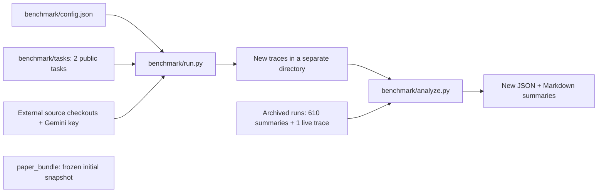

# Finding Needles in Code Haystacks

Research artifact for studying how coding agents discover specifications and
turn them into patches: a public harness, two task fixtures, and preserved results.



| Start here | Purpose |
| --- | --- |
| [Workflow and limits](docs/RESEARCH_WORKFLOW.md) | Setup, safe analysis, implemented provider support |
| [Frozen results](report.md) · [JSON](results.json) · [Records](runs/) | Original outputs; 610 evaluation summaries and one later HTTP 429 trace |
| [Public protocol](PAPER_APPENDIX.md) · [Task fixtures](benchmark/tasks/) | Specifications, hashed tests, budgets, and conditions |
| [Bundle snapshot](paper_bundle/README.md) | Historical three-model config and distinct analysis, preserved verbatim |
| [Original README](docs/README.original.md) | Earlier research claims and replication estimates, retained with context in the workflow guide |

**Offline first — Python 3, no API key or package install:**

```bash
python3 scripts/check_artifacts.py
mkdir -p analysis
python3 benchmark/analyze.py --runs runs --output analysis/results.json --report analysis/report.md
```

Maintain the root `benchmark/` pipeline. Keep `paper_bundle/`, archived records,
and frozen outputs unchanged. [Read the evidence and reproducibility limits](docs/RESEARCH_WORKFLOW.md#artifact-evidence-and-limits)
before interpreting the results or starting paid runs.
